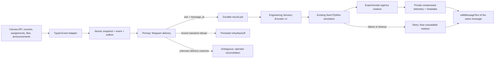

> Historical phase report. Current release behavior and validation are in [FINAL_RELEASE_REPORT.md](FINAL_RELEASE_REPORT.md) and [DEPLOYMENT.md](DEPLOYMENT.md).

# FlyMind Phase 3 — Canvas → Neural Engine → Telegram

Интеграция реализована в `feat/flymind-neural-poc`, **выключена по умолчанию**.
Продакшен не менялся: миграции подготовлены, но применялись только к отдельной
временной PostgreSQL-базе; реальных Telegram-сообщений не отправлялось, push/deploy нет.
Предыдущие незакоммиченные изменения и все биологические данные/эксперименты сохранены.

## Поток события



Один конечный Python worker запускается существующим GitHub Actions. При
`FLYMIND_ENABLED=false` `src/main.py` выполняет прежний путь и не импортирует Neural Engine.
Неудачный install optional Brian2 dependencies имеет continue-on-error и выключает
neural side-path для этой job, сохраняя Canvas delivery. При `true` используется новый durable путь; старые process_assignments/files/announcements
не вызываются параллельно, поэтому двойной доставки из двух implementation paths нет.

Порядок: восстановить ранее queued первичные уведомления → scan → CAS snapshot/event/outbox
→ доставка первичных сообщений → ограниченное число neural jobs → обновление уже
доставленных сообщений. Расчёт не блокирует первичное уведомление и не может понизить
его обязательную срочность. Если Canvas временно недоступен, старый outbox всё равно
обрабатывается. Если credentials Telegram отсутствуют, jobs остаются pending без claim.

Для courses/assignments/announcements читаются страницы Canvas Link API с ограничением
100 страниц, retries на временные ошибки и запретом cross-origin pagination/redirects.
Один недоступный курс не подавляет события других; snapshot его заданий не заменяется
пустыми данными. Files сохраняют прежнюю область «последние десять», announcements — 30 дней.
Удаления объектов не моделируются. Polling не может увидеть изменения, исчезнувшие между
двумя сканированиями; GitHub schedule не гарантирует точную пятиминутную периодичность.

## Типизированный Event Adapter

`CanvasEvent` — Pydantic frozen model v1: account, entity key, revision, observed_at UTC,
kind, priority, payload, changes, reminder. Assignment creation, deadline change,
grade update и reminder — отдельные события. Одновременные изменения deadline/score
не теряются из-за прежнего приоритета UPDATED_GRADE. Дополнительно сохраняются изменения
points_possible, files/announcements и системные GPA/weekly-health reports.

Ключ обычного события: SHA-256(account, entity, key, kind, snapshot revision).
Повторное наблюдение того же состояния не создаёт события. Настоящие повторные переходы
80→90→80→90 получают разные revisions. Reminder key включает срок и band, а не время job;
после пропущенного cron отправляется ближайший актуальный band, а не все прошлые окна.
Bands: 48/24/12/3/1 h и overdue; submitted assignment не напоминается. Новая due date
имеет независимый набор reminders. Даты без timezone и нечисловые/нефинитные grades
отклоняются; private payload не выводится в logs.

SQL RPC `flymind_commit` блокирует snapshot, проверяет expected revision и в одной
транзакции сохраняет snapshot, event и send/simulate jobs. После конфликта worker перечитывает
состояние. При первом чтении используется существующий `canvas_state`, если он есть;
его reminder marker переносится в новый формат. Silent `--bootstrap` отдельно позволяет
зафиксировать первоначальный baseline без Telegram или neural calls.

## Sensory Encoder и readout

Это **инженерная интерпретация Canvas-событий как условных sensory inputs**, а не
утверждение, что муха воспринимает оценки и дедлайны. Encoder `canvas-looming/v1`
использует только два уже исследованных протокола:

- weak: contrast 0.35, r/v 80 ms;
- strong: contrast 1, r/v 20 ms.

Strong выбирается для незавершённого задания со сроком ≤24 h, reminders ≤12 h/overdue,
либо grade update с score/points_possible <0.6. Остальные assignment events → weak.
Эти thresholds инженерные; observed_at сохраняется, чтобы retry не перекодировал
событие по новым часам. System/file/announcement events не стимулируют сеть.

Используется существующий `src.neural.escape case`, настоящие 1 500 FlyWire FAFB v783
IDs и неизменённая топология/аннотации; generic literature_parameters,
`presynaptic_shiu`, `exponential_current`. Нет обучения, ANN, пластичности или
подбора membrane/synapse parameters ради вида уведомлений. Прямой drive GF запрещён.
Child получает только имя проверенного профиля, не Canvas IDs, названия, оценки,
токены или Supabase credentials. Fresh subprocess имеет timeout 30 s и one-thread численные
библиотеки. После расчёта сохраняются activity hash, пять hashes файлов engine,
parameters/provenance в исходном gzip и measurement metadata.

`experimental-urgency/v1`:

- elevated: сумма GF spikes ≥6 и active neurons ≥400;
- moderate: GF spikes ≥1 либо active neurons ≥100;
- иначе minimal.

Это engineering-defined urgency signal, **не biological escape validation**.
Модельная activity и thresholds не заменяют обязательные правила Canvas: незавершённый
срок ≤3 h / overdue получает critical независимо от GF. Readout содержит population
spikes, active cells, GF counts, first latency и model depolarization; suprathreshold
peak зависит от LIF reset и не равен амплитуде action potential.

Протоколы грубые, поэтому большинство событий одного профиля дают один и тот же
нейронный ответ. Это не независимая доказанная оценка жизненной срочности. Сохраняются
ограничения первой фазы: неполные GF inputs, generic LIF, некалиброванный visual drive,
неподтверждённая receptor polarity, отсутствие VNC/gap junctions/behavioral validation
и невалидированная LPLC2 dependence.

## Доставка и граница exactly-once

Primary сообщения имеют immutable event reference; neural enrichment выполняется
`editMessageText` по сохранённому message_id, а не второй отправкой. HTML Canvas titles
экранируются. Статусы durable jobs: pending → running → done, либо retry/pending,
ambiguous/dead. Claim — `FOR UPDATE SKIP LOCKED`, lease 120 s, token guard для ack.
Late/duplicate ack не завершает чужой lease. Attempts/backoff сохраняются между jobs;
429 retry_after учитывается, known refusal retries ограничены десятью attempts.
Neural/storage failure retry — три attempts; затем unavailable readout в том же сообщении.

[Telegram sendMessage](https://core.telegram.org/bots/api#sendmessage) не предоставляет
idempotency key. Поэтому абсолютная exactly-once доставка при потерянном ответе
недостижима с текущим Bot API. Здесь:

- duplicate event/job после успешного ack не отправляет primary снова;
- ConnectError до передачи запроса / explicit Bot API `ok=false` transient error можно retry;
- Read/Write timeout, неизвестный gateway result, потерянный DB ack после успешного send
  или истёкший send lease → **ambiguous без автоматической повторной отправки**;
- истёкший simulation/edit lease можно восстановить: simulation детерминированна,
  edit меняет существующее message_id; «message is not modified» считается успешным edit.

Ambiguous требует оператора: сверить event reference в разрешённом Telegram-чате и
привязать найденный message_id через `flymind_reconcile`. Только после подтверждения
отсутствия доставки разрешён explicit requeue. Иначе можно получить дубль. Это
осознанная граница между гарантией отсутствия автоматических дублей и liveness при
неизвестном результате. Dead jobs не исчезают; исправление конфигурации и операторское
восстановление нужны для permanent отказов (например, бот заблокирован).

GPA report при workflow_dispatch привязан к `GITHUB_RUN_ID`, поэтому job retry не
дублирует отчёт. Weekly health — calendar-week key. Они проходят тот же outbox без
neural stimulation. /stats через уже существующий webhook остаётся отдельным legacy
interactive path; его собственная HTTP доставка не переводилась на этот worker outbox.

## Хранение и приватность

Подготовлены две миграции:

1. `202610140001_flymind_integration.sql`: accounts, snapshots, events, jobs,
   experiments; worker-only RPCs, owner SELECT policies, private Storage bucket.
2. `202610140002_flymind_legacy_privacy.sql`: RLS + revoke anonymous/client writes для
   существующих canvas_state/course_grades/health_checks; owner-only SELECT по mapping
   Telegram account → Supabase Auth owner. Service-role worker/webhook сохраняют доступ.

Ни одна не применялась к production. Первая не меняет legacy data/columns;
вторая намеренно меняет только права и policies после отдельной проверки staging.

Canvas payload хранится только в защищённых tables. `flymind-private` bucket не public;
путь `{account UUID}/{event digest}/{compressed SHA-256}.json.gz`. Upload не делает upsert;
при потерянном upload ack допускается reuse только byte-identical объекта. Metadata/event
association сохраняется транзакционно после upload. При сбое между upload и DB commit
возможен private orphan object: нужен отдельно согласованный retention/cleanup, не
автоматическое удаление в этой задаче. Результат доставки Telegram и Storage upload
не являются одной общей distributed transaction.

Anonymous access и чужой owner блокируются. Restrictive Storage guard защищает новый
bucket даже при старой широкой permissive policy; другие buckets не закрываются.
Frontend может только читать свои metadata/objects, а не вызывать worker RPC, менять
Canvas snapshots или загружать private telemetry. Owner UUID назначается только
администратором после проверки принадлежности аккаунта; NULL означает worker-only data.
[Supabase private Storage/RLS](https://supabase.com/docs/guides/storage/security/access-control).

`dashboard/src/supabase.ts` — authenticated repository с user JWT и publishable key,
no-store requests, SHA-256 verification, gzip decoding и lossless адаптацией Engine JSON
к существующему Observatory v1. Service-role/secret keys в browser запрещены. Default
local HTTP replay не менялся. Auth/login UI и переключатель private datasets пока не
подключены; репозиторий функционален и проверен на реальном compressed engine export.

## Локальное воспроизведение

```bash
.venv/neural/bin/python -m pytest -q --tb=short --disable-warnings
npm --prefix dashboard test
npm --prefix dashboard run build
# SYNTHETIC Canvas input + REAL connectome; capture transport, no network messages:
.venv/neural/bin/python -m src.flymind.demo --output /private/tmp/flymind-new-demo
```

Demo output должен быть новым. SQLite/blob files имеют private file permissions;
не загружать настоящие snapshots/telemetry в GitHub artifacts или public dashboard/data.
Пример конфигурации: `docs/flymind-env.example`, без значений secrets.

SQL tests используют отдельный локальный PostgreSQL с тестовыми stand-in auth/storage
schemas. Это проверка настоящего PostgreSQL/RLS, но не live Supabase Storage/PostgREST.
После создания isolated cluster под `/private/tmp/flymind-*`:

```bash
.venv/neural/bin/python tests/flymind/postgres_checks.py \
  --socket /private/tmp/flymind-phase3-pg --port 55439 \
  --psql /opt/homebrew/opt/postgresql@16/bin/psql
```

Script создаёт новую **test** database, применяет обе миграции, проверяет RPC/ownership,
затем удаляет только эту test database. Production URL не принимается.

## Точные шаги до production activation

1. Сохранить/review изменения ветки отдельно. Данные FlyWire, engine modules и existing
   experiments должны пройти hash/source checks; выполнить tests/build и локальное demo.
   Ничего из этого не было pushed/deployed автоматически.
2. В отдельной staging Supabase применить **обе** миграции в указанном порядке. Проверить
   реальные PostgREST RPC, Storage upload/download, существующие grants/policies и webhook
   service-role доступ. Проверить anon, wrong-owner и correct-owner JWT. Старые неизвестные
   SECURITY DEFINER RPC также требуют проверки: SQL fixtures не знают production extensions.
3. Создать `flymind_accounts` запись: verified Telegram chat_id, точный Canvas origin,
   собственный UUID account и при необходимости verified `owner_id` из auth.users.
   Убедиться, что Canvas token принадлежит ожидаемому пользователю. Включить DB account
   `enabled=true` только для staging/планируемой активации. Не использовать пример UUID как
   production account. Аккаунт не создаётся worker-ом автоматически.
4. Настроить GitHub **Secrets**: CANVAS_API_URL, CANVAS_API_KEY, SUPABASE_URL,
   SUPABASE_SERVICE_KEY (service-role, не anon), TELEGRAM_BOT_TOKEN, TELEGRAM_CHAT_ID.
   В **Variables**: FLYMIND_ACCOUNT_ID; FLYMIND_ENABLED пока `false`;
   FLYMIND_NEURAL_ENABLED сначала `false`; FLYMIND_MAX_NEURAL, например `5`.
   Проверить разрешённый chat/origin mapping; не помещать service key в Vite variables.
5. На staging получить baseline через явно разрешённый silent bootstrap:
   `FLYMIND_ENABLED=true python -m src.flymind.worker --bootstrap` с private credentials.
   Bootstrap не делает send/edit/compute даже при ранее pending outbox. Решить заранее,
   какие existing snapshots/reminders переносить; текущие critical задания не считать
   вновь созданными без причины.
6. Протестировать обычную доставку, job retry, 429, Canvas outage, missing Telegram token,
   lost send ack и ручной reconcile. После проверки включить neural mode и проверить
   compressed metadata/event association + enrichment без второго сообщения.
7. После отдельного разрешения применить проверенные миграции/config к production,
   повторить binding/baseline проверки и только тогда поставить GitHub Variable
   `FLYMIND_ENABLED=true`. `FLYMIND_NEURAL_ENABLED=true` включить после outbox pilot.
   Rollback neural-only: `FLYMIND_NEURAL_ENABLED=false` сохраняет durable основной путь.
   Полное выключение `FLYMIND_ENABLED=false` возвращает legacy sender; сначала обработать/
   сверить pending/ambiguous outbox и синхронизировать snapshot baseline, иначе переход
   между независимыми legacy/new stores может повторно показать изменения.
8. Наблюдать job status и send.pending/ambiguous/dead; определить оператора recovery,
   private-data retention и Storage orphan cleanup. Нельзя обещать absolute exactly-once
   поверх Bot API. Подключение Auth/private source UI Observatory — отдельный следующий шаг.

## Проверенные результаты

Полный Python suite: **118 passed**, 172 Brian2/pyparsing deprecation warnings,
50.78 s. Frontend: **25 Vitest passed**, TypeScript/Vite build успешен; остаётся прежний
Three.js vendor-chunk advisory. Статический local replay: **4/4 Playwright scenarios passed**.
Обе миграции прошли actual PostgreSQL 16 tests для CAS/deduplication/claim/ack и RLS:
owner, other owner, anon, worker RPC privileges, private Storage guard и legacy grade privacy.
Это не live Supabase API test.

Offline demo: SYNTHETIC Canvas creation → deadline/grade/reminder и настоящий FlyWire
runner; **4 primary captures + 4 edits того же message_id**, повторный poll — **0 новых
доставок**. Weak: **344 spikes, 282 active, GF 2/2**, first latencies **751.1/750.0 ms**.
Strong: **834/418, GF 3/4**, latencies **179.8/179.6 ms**. Все пять source hashes engine
и SHA-256 исходных CSV совпали с существующими экспериментами. Ни один biological
parameter/data file не изменён. Результаты: [flymind-phase3-results.json](flymind-phase3-results.json).

Основные новые файлы: `src/flymind/{events,sensory,neural,pipeline,store,telegram,scanner,
worker,reports,presentation,demo}.py`, `tests/flymind/`, обе `supabase/migrations/`,
`dashboard/src/{supabase,integrity}.ts`, private-source tests и env example.
В существующих tracked файлах изменены только gated entry point `src/main.py` и
Actions configuration; `tests/test_scanner.py` был изменён до этой фазы и сохранён.
`dashboard/src/data.ts` расширен exports, default local source сохранён.
